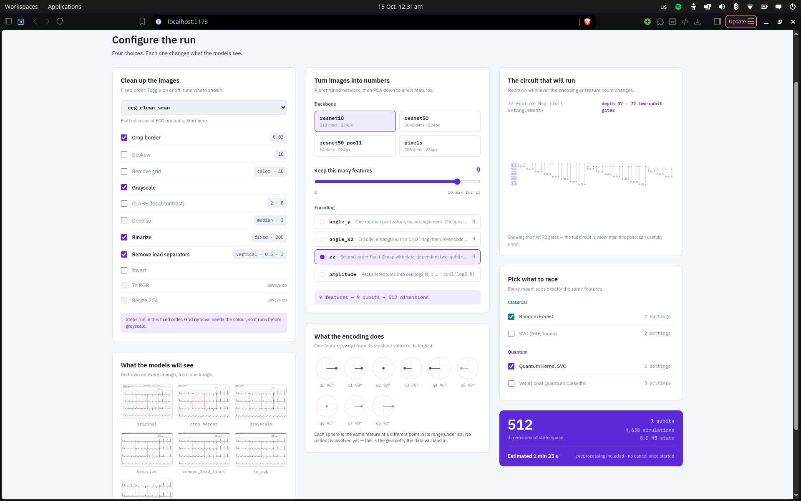
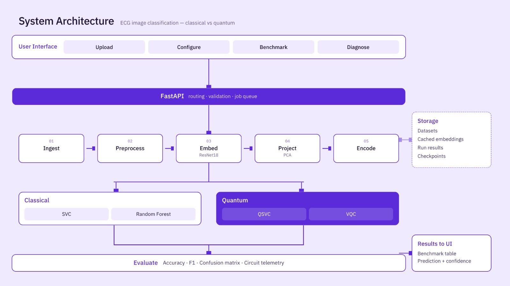
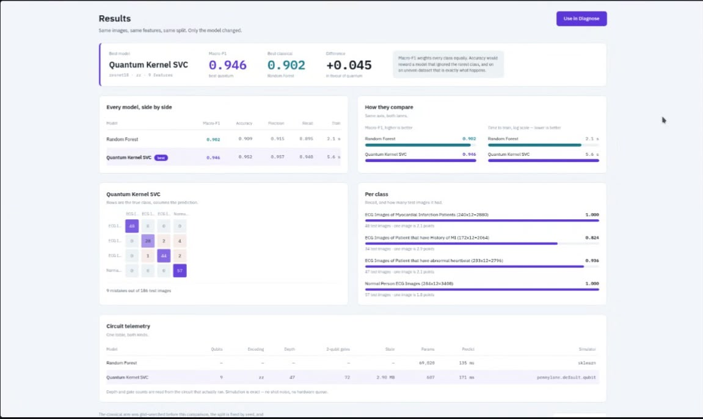

# QuBench

**A hybrid quantum–classical classifier for early cardiac abnormality detection**
PS-Q1 · Biomedical Signal Classifier

QuBench takes ECG recordings, compresses each one into a handful of numeric
features, angle-encodes those features into a small quantum circuit, trains a
**variational quantum classifier (VQC)** with a classical optimizer, and then
races it against classical models that see **exactly the same features, the
same split and the same preprocessing**.

It is a complete platform rather than a single notebook: upload a dataset,
configure the pipeline, watch the circuit being drawn, train, compare, and
diagnose a single ECG, all from one interface and one REST API.

<p align="center">
  
</p>

---

## Table of contents

- [The problem statement](#the-problem-statement)
- [How QuBench answers it](#how-qubench-answers-it)
- [System architecture](#system-architecture)
- [The VQC and the quantum models](#the-vqc-and-the-quantum-models)
- [Feature extraction and angle encoding](#feature-extraction-and-angle-encoding)
- [Metrics and circuit-resource reporting](#metrics-and-circuit-resource-reporting)
- [Results](#results)
- [Beyond the brief](#beyond-the-brief)
- [Quickstart](#quickstart)
- [The five screens](#the-five-screens)
- [API](#api)
- [Storage](#storage)
- [Testing](#testing)
- [Extending it](#extending-it)
- [Troubleshooting](#troubleshooting)
- [Layout](#layout)

---

## The problem statement


In short: classify ECG segments as normal vs abnormal with a hybrid VQC,
encoding 4–8 numeric features into a 4–8 qubit circuit by angle encoding,
training the circuit parameters with a classical optimizer, and comparing
against a classical baseline on the same features. Recall is the primary
metric, because missing an abnormal case is costlier than a false alarm.

---

## How QuBench answers it

| What the PS asks for | What QuBench ships |
| --- | --- |
| Hybrid quantum–classical **variational classifier** | `VQCModel`: data encoding → trainable `StronglyEntanglingLayers` (1–6 layers) → ⟨Z⟩ on every qubit → linear readout head. Parameters are trained by the **Adam** optimizer on mini-batches with exact gradients (`diff_method="backprop"` on PennyLane's `default.qubit`). |
| Classify cardiac signals, **normal vs abnormal** | ECG classification end to end, validated on a 4-class cardiac dataset (Normal / abnormal heartbeat / MI / history of MI). The class count is a constructor argument everywhere, so **2-class and 4-class runs take the identical code path**; the model matrix self-test covers both. |
| **4–8 numeric features** per segment | Every ECG is reduced to **N features** (default 8, slider 2–12 for angle encodings) by a preprocessing → pretrained embedding → PCA pipeline. N is a first-class control on the Configure screen. |
| **Angle encoding** into a **4–8 qubit** circuit | `angle_y` (one RY rotation per feature, one qubit per feature, **zero** entangling gates) and `angle_x2` (encode → CNOT ring → re-encode). N features map to N qubits, so the 4–8 qubit range is the default operating range. |
| **Normalize features to [0, π]** before encoding | Each encoding declares its own scaler. `angle_y` and `angle_x2` use `MinMaxScaler(0, π)`, fitted on the **training split only**. Encoding, qubit count and scaler are bound together and cannot be mismatched. |
| Train circuit parameters with a **classical optimizer** | Adam with a configurable learning rate, batch size, epochs and ansatz depth. The per-epoch loss history is recorded for every VQC run. |
| Compare against a **classical baseline on the same features** | **SVC** (RBF / linear / polynomial, grid-searched with stratified CV before every comparison) and **Random Forest** (balanced class weights). All models receive the identical `X : float32[n, N]`; nothing else crosses into the model layer. |
| **Accuracy, F1, recall** | Accuracy, macro-F1, macro-precision and **macro-recall** for every model, plus **per-class recall** with test-set support, and a confusion matrix per model. |
| **Circuit-resource table** (depth, two-qubit gates) | The telemetry table reports qubits, **circuit depth**, **two-qubit gate count**, state-vector memory, trainable parameters and fit/predict time, **read from the real decomposed circuit** with `qml.specs(level="device")`. |
| **Circuit diagrams** | The Configure screen draws the actual decomposed circuit for the selected encoding and feature count (click to zoom), plus a Bloch-sphere fan showing what the encoding does to a feature across its range. |
| **Fixed train/test split** | Stratified 80/20 split, seed 42, one function (`project.py`) that always splits first and fits second. Fully reproducible. |
| **Class imbalance** | Macro-averaged metrics everywhere, a stratified split, balanced class weights in the Random Forest, and an automatic imbalance warning at 3:1 or worse. |
| Use **PennyLane** rather than a hand-rolled training loop | PennyLane throughout. `qml.specs` for resource counts, `qml.StronglyEntanglingLayers` for the ansatz, `qml.AdamOptimizer` for training. |
| **Honest baseline comparison** | The classical arm is tuned by default, PCA and every scaler see only training rows, and the same split feeds every model. A reported gap is a controlled comparison, not an artefact of an untuned baseline. |

---

## System architecture

<p align="center">
  
</p>

A React interface talks to a FastAPI layer, which drives a pure-Python core:
`ingest → preprocess → embed → project → encode`, then fans out to the
classical (SVC, Random Forest) and quantum (QSVC, VQC) arms, and converges on
a single evaluation step.

<details>
<summary><b>Layer-by-layer view</b> (click to expand)</summary>

```
┌──────────────────────────────────────────────────────────────────────────┐
│  FRONTEND — React · Vite · Tailwind v4                                   │
│                                                                          │
│   Upload ─► Configure ─► Benchmark ─► Diagnose        Leaderboard        │
│                                                                          │
│   api.js  ← the ONLY file that calls fetch(). Everything else takes props│
│   No model, op, encoding, backbone or class name appears in any .jsx     │
└───────────────────────────────┬──────────────────────────────────────────┘
                                │  REST/JSON · 800 ms job polling
┌───────────────────────────────┴──────────────────────────────────────────┐
│  API LAYER — FastAPI                                                     │
│   main.py      17 routes, zero ML logic, every body under ~15 lines      │
│   schemas.py   Pydantic mirrors of the dataclasses + a drift guard       │
│   validate.py  error rules + warning rules, live on every change         │
│   jobs.py      SEAM 5 · background worker, one run at a time             │
│   store.py     SEAM 6 · six functions over JSON files                    │
└───────────────────────────────┬──────────────────────────────────────────┘
                                │  plain Python calls · no HTTP below here
┌───────────────────────────────┴──────────────────────────────────────────┐
│  CORE — pure Python. `import fastapi` appears nowhere below this line.    │
│                                                                          │
│  ┌── data in ──────────────┐   ┌── features out ──────────────────────┐  │
│  │ ingest.py     SEAM 1    │   │ embed.py      SEAM 3   4 backbones   │  │
│  │ preprocess.py SEAM 2    │   │ encodings.py  SEAM 3.5 4 encodings   │  │
│  │                         │   │ project.py    split → PCA → scaler    │  │
│  │  ── HANDOFF ───────────►│   │ registry.py   SEAM 4   4 models      │  │
│  │  uint8[n,224,224,3]     │   │ models_classical · models_quantum    │  │
│  │  y:int[n], class_names  │   │ benchmark.py  orchestrator           │  │
│  │                         │   │ estimate.py   cost model             │  │
│  └─────────────────────────┘   │ checkpoint.py bundle save/load       │  │
│                                └──────────────────────────────────────┘  │
│                                                                          │
│    ══════════════ THE INVARIANT ═══════════════════════════════          │
│    X : float32[n, N]   y : int[n]   class_names : list[str]              │
│    Nothing else crosses into the model layer. Ever.                      │
└───────────────────────────────┬──────────────────────────────────────────┘
                                │
┌───────────────────────────────┴──────────────────────────────────────────┐
│  STORAGE — flat files, no database                                       │
│  storage/datasets/{ds_id}/{class}/*      ingested images                 │
│  storage/artifacts/{ds_id}__{backbone}__{ops_hash}.npy   embedding cache │
│  storage/checkpoints/{run_id}__{model}.pkl               trained bundles │
│  storage/datasets.json · runs.json · calibration.json                    │
└──────────────────────────────────────────────────────────────────────────┘
```

</details>

### The run lifecycle

```
POST /datasets   zip → classes inferred from folder names → stratified
                 subsample to ≤1000 (floor of 10/class) → 4 preview thumbs

Configure        five catalog endpoints drive every control on the screen
                 validate + estimate + preview refire on every change

POST /runs       validated again server-side, then a background job:
                   5%  ingest      load recordings from disk
                  20%  preprocess  apply cfg.ops per recording
                  ──── HANDOFF ────────────────────────────
                  55%  embed       backbone forward, or cache hit
                  60%  project     split → PCA(N) → encoding scaler
               60-95%  train       each model: fit, predict, metrics,
                                   telemetry, checkpoint
                 100%  save        store.save_run(record)

GET /jobs/{id}   polled every 800 ms; status, pct, message
GET /runs/{id}   metrics, confusion matrices, per-class, telemetry
POST /predict    one recording, replaying the checkpoint's OWN recipe
```

### The invariant

```
ingest → preprocess → embed → project → encode → train → evaluate
```

Everything upstream of the model layer collapses to exactly:

```
X : float32[n, N]     y : int[n]     class_names : list[str]
```

Models never see images, file paths, or a `DatasetMeta`. `n_classes` is always
a constructor argument, and `BaseModel.fit()` raises if any label falls outside
`[0, n_classes)`. PCA and every scaler are fitted on the **training split
only**; `project.py` does the split first and the fit second, in one function,
so test-set structure can never leak into the components.

---

## The VQC and the quantum models

```
  features x ∈ ℝᴺ ──► scaler [0, π] ──► angle encoding ──► StronglyEntanglingLayers(θ)
                                                                    │
                                              ⟨Z₀⟩ ⟨Z₁⟩ … ⟨Z_{N−1}⟩ ◄┘
                                                                    │
                                          Linear(N → n_classes) ──► softmax ──► class
```

**Variational Quantum Classifier (`vqc`).** The encoding circuit loads the
features, a trainable `StronglyEntanglingLayers` block (1–6 layers) processes
them, and the Pauli-Z expectation of every qubit feeds a linear head sized from
`n_classes`. Adam updates the circuit weights and the head together.

- **Exact gradients, no deep-learning framework.** `diff_method="backprop"` on
  `default.qubit` differentiates the simulator directly, so the entire model
  layer needs only `numpy + scikit-learn + pennylane`. Torch is confined to the
  embedding step, where a pretrained CNN genuinely requires it.
- **Near-identity initialisation** of the circuit weights, so training starts
  away from barren plateaus.
- **Loss history** recorded per epoch during training.
- **Checkpointable.** QNodes are dropped on pickle and rebuilt on load, so a
  trained VQC can be reopened later in the Diagnose screen.

**Quantum Kernel SVC (`qsvc`).** A fidelity kernel
`K(x, y) = |⟨φ(x)|φ(y)⟩|²` feeding a precomputed-kernel SVC. A bonus second
quantum arm that shares the same encodings and the same features.

- **The Gram matrix is built from cached statevectors**: simulate each sample
  once, then take inner products with one BLAS call. That is O(n) simulations
  instead of the O(n²) compute-uncompute circuits a pairwise fidelity kernel
  needs. Identical numbers, minutes into seconds.
- **The kernel bandwidth is cross-validated, not assumed.** Fidelity kernels
  concentrate, so the bandwidth is searched together with C. Measured on our
  data, `zz` scores **0.774 untuned and 0.903 tuned**.

**Classical arm (`svc`, `rf`).** SVC grid-searches kernel, C, gamma and degree
under stratified CV scored on macro-F1. Random Forest uses balanced class
weights and exposes per-component feature importances. Both expose the
hyperparameters they chose.

Simulation is exact statevector: noiseless, no shot noise, no hardware queue.
The interface says so wherever a number is shown.

---

## Feature extraction and angle encoding

**Preprocessing**: 11 operations in a fixed execution order, with four presets
(`raw` · `ecg_clean_scan` · `ecg_grid_paper` · `ecg_photo`):

```
100 crop_border   200 deskew    300 remove_grid   400 grayscale
500 clahe         600 denoise   700 binarize      800 remove_lead_lines
850 invert        900 to_rgb (locked)             1000 resize (locked)
```

Order is a property of the operation, not of the config: `remove_grid`
identifies ECG paper by colour saturation, so it must run before `grayscale`.
`apply_ops` sorts by order however the list arrives, and a live preview strip
shows the recording after every stage.

**Feature extraction**: a pretrained backbone embeds each cleaned recording,
then PCA compresses the embedding to N components (fitted on training rows
only):

| Backbone | Embedding dims |
| --- | ---: |
| `resnet18` | 512 |
| `resnet50` | 2048 |
| `resnet50_pool1` | 64 |
| `pixels` | 256 |

**Encodings**: each one binds qubit count, scaler and circuit together.

| Encoding | Qubits | Max features | Scaler | Character |
| --- | --- | ---: | --- | --- |
| `angle_y` | N | 12 | MinMax [0, π] | One RY rotation per feature. Depth 1, **zero** entangling gates. The cheapest circuit and the control for every entanglement comparison. |
| `angle_x2` | N | 12 | MinMax [0, π] | Encode, entangle with a CNOT ring, then re-encode. |
| `zz` | N | 10 | MinMax [0, 2π] | Second-order Pauli-Z feature map with data-dependent two-qubit rotations. |
| `amplitude` | ⌈log₂ N⌉ | 64 | L2 normalise | Packs N features into log₂ N qubits. |

Measured at 8 features: `angle_y` is depth 1 with no entangling gates; `zz` is
depth 41 with 56 two-qubit gates. At 9 features `zz` is depth 47 with 72, as
shown in the screenshot above. The Configure screen shows the live qubit and
Hilbert-space dimension for every selection ("9 features → 9 qubits → 512
dimensions").

---

## Metrics and circuit-resource reporting

Every run reports, for every model, on the same held-out split:

- **Accuracy, macro-F1, macro-precision, macro-recall.**
- **Per-class precision, recall and F1** with the test-set support, and how many
  percentage points a single image is worth for that class.
- **A confusion matrix per model**, with the full label set pinned so a class a
  model never predicts still appears as a row.
- **Circuit telemetry in one table for both kinds of model**: qubits, encoding,
  circuit depth, two-qubit gate count, state-vector memory, trainable
  parameters (support vectors for SVC, node count for RF, weights for VQC),
  fit time, predict time, kernel bandwidth, and the simulator used.

Depth and gate counts are read from the circuit that actually ran, with
`qml.specs(level="device")`, so templates are expanded into real gates instead
of being counted as one.

<p align="center">
  
</p>

*The Results screen for a 4-class run (`resnet18 · zz · 9 features`, 186 held-out
test images): the hero strip with the quantum/classical delta, every model side
by side, accuracy and log-scale training-time bars, the confusion matrix,
per-class recall, and the circuit-telemetry table.*

---

## Results

Same images, same features, same split. Only the model changes.

**Run shown above**: Quantum Kernel SVC reaches macro-F1 **0.946** against
**0.902** for the best classical model (Random Forest), with accuracy 0.952 and
macro-recall 0.948. Per-class recall is 1.000 for Myocardial Infarction, 0.824
for History of MI, 0.936 for abnormal heartbeat and 1.000 for Normal.

**Controlled sweep** on the Ch. Pervaiz Elahi Institute of Cardiology ECG
image dataset (Khan, Hussain & Malik, *Data in Brief*, 2021), balanced to 74
images per class. Macro-F1, 80/20 stratified, seed 42:

| backbone · encoding · features   | best classical | best quantum |      delta |
| -------------------------------- | -------------: | -----------: | ---------: |
| `resnet50_pool1` · `angle_y` · 8 |          0.577 |    **0.608** | **+0.031** |
| `resnet18` · `angle_y` · 8       |          0.532 |        0.533 |     +0.001 |
| `resnet18` · `zz` · 8            |          0.517 |        0.517 |      0.000 |
| `resnet18` · `amplitude` · 16    |          0.531 |        0.494 |     −0.037 |

Macro-F1 is the headline metric across the product because it weights every
class equally: accuracy alone would reward a model that ignored the rarest
class.

**Timing** at 742 training samples: SVC grid-searched 6.6 s · Random Forest
0.6 s · QSVC tuned 0.9 s · VQC ~30 s at 15 epochs. ResNet18 embeds at ~23
ms/image, and every embedding is cached, so moving the feature slider or
switching encodings never re-embeds.

---

## Beyond the brief

The PS asks for a standard VQC pipeline with an honest baseline comparison.
QuBench delivers that and the platform around it:

- **A full web application**: five screens (Upload, Configure, Benchmark,
  Diagnose, Leaderboard) with live validation, a cost estimate before every
  run, and a progress ladder with a live activity transcript and circuit
  telemetry while a job runs.
- **A 17-route REST API** with auto-generated docs at `/docs`, and Pydantic
  schemas guarded against drift from the core dataclasses.
- **Two quantum models, not one**: the VQC and a fidelity-kernel QSVC with
  cross-validated bandwidth, on the same encodings and the same features.
- **Four encodings and four backbones**, including an entangling `zz` feature
  map and amplitude encoding, so "does entanglement help?" is a measurable
  question against the zero-entanglement `angle_y` control.
- **A real circuit view**: the actual decomposed circuit, drawn live as the
  encoding or feature count changes, plus Bloch-sphere fans that show the
  geometry the data will land in.
- **Diagnose**: run one recording through any trained model, with per-class
  confidence bars and the patient's own Bloch angles, using the checkpoint's
  own recipe (never the live config), with a "not a medical device" strip.
- **Leaderboard**: best classical vs best quantum per dataset, across every run.
- **A cost model** calibrated to the machine it runs on: qubits, Hilbert
  dimension, simulations, memory and estimated seconds, shown before Run.
- **Input validation** with blocking errors and advisory warnings (imbalance,
  tiny test sets, over-wide feature counts, qubit caps) that refire on every
  change.
- **Headless mode**: `scripts/pipeline.py` runs the entire pipeline from the
  command line with no web layer, including a `--synthetic` mode that needs no
  dataset at all.
- **No heavy infrastructure**: CPU only, no GPU, no database, no Docker, no
  quantum hardware.
- **Self-testing code**: every module carries its own self-test, plus a
  one-command suite that exercises all 17 routes in-process, and 17 fixtures
  regenerated from live code that also drive a **no-backend mock mode**.
- **Cross-platform**: bash and PowerShell launchers and documented quickstarts
  for macOS, Linux and Windows.
- **Built to extend**: six plug-in seams, each a plain Python dict. A new model,
  encoding, backbone, preprocessing operation or data modality is one function
  and one dict entry, with no frontend changes.

---

## Quickstart

Requires **Python 3.11+** (PennyLane 0.45 will not install on 3.10) and
**Node 18+**. No GPU, no database, no Docker, no quantum hardware.

### macOS / Linux

```bash
git clone https://github.com/Greek1606/QuBench && cd QuBench

# --- backend -------------------------------------------------------------
python3 -m venv .venv
source .venv/bin/activate

# CPU torch FIRST. The default PyPI wheel pulls ~2.5 GB of CUDA packages this
# project never executes.
pip install torch==2.14.0 torchvision==0.29.0 \
    --index-url https://download.pytorch.org/whl/cpu
pip install -r backend/requirements.txt

# --- frontend ------------------------------------------------------------
cd frontend && npm install && cd ..

# --- run both ------------------------------------------------------------
./run.sh all
```

|               |                                |
| ------------- | ------------------------------ |
| App           | <http://localhost:5173>        |
| API docs      | <http://localhost:8000/docs>   |
| What is wired | <http://localhost:8000/health> |

`./run.sh api` and `./run.sh web` start one half each.
`cd frontend && VITE_MOCK=true npm run dev` runs the whole UI from generated
fixtures with no Python at all.

### Windows

Use **PowerShell**, not `cmd`: the activation script and `run.ps1` both assume it.

```powershell
git clone https://github.com/Greek1606/QuBench
cd QuBench

# --- backend -------------------------------------------------------------
python -m venv .venv
.\.venv\Scripts\Activate.ps1

pip install torch==2.14.0 torchvision==0.29.0 `
    --index-url https://download.pytorch.org/whl/cpu
pip install -r backend\requirements.txt

# --- frontend ------------------------------------------------------------
cd frontend; npm install; cd ..

# --- run both (opens two PowerShell windows) -----------------------------
.\run.ps1 all
```

`run.ps1` is the Windows equivalent of `run.sh` and takes the same arguments
(`api`, `web`, `all`).

<details>
<summary><b>Windows notes</b> (click to expand)</summary>

**Execution policy.** If `Activate.ps1` fails with "running scripts is
disabled", allow it for your user once:

```powershell
Set-ExecutionPolicy -Scope CurrentUser -ExecutionPolicy RemoteSigned
```

**`python`, not `python3`.** If a bare `python` opens the Microsoft Store,
install Python from python.org and tick *Add python.exe to PATH*.

**`curl` is `Invoke-WebRequest`** in PowerShell. Use `curl.exe` explicitly:

```powershell
curl.exe -s localhost:8000/health
curl.exe -s -F "file=@C:\path\to\ecg.zip" localhost:8000/datasets
```

**Environment variables use `$env:`**:

```powershell
$env:BAL = (python -c "from backend import store; print(next(d.dataset_id for d in store.list_datasets() if 'balanced' in d.name.lower()))")
python -m scripts.pipeline --dataset-id $env:BAL --backbone resnet18 --features 8
cd frontend; $env:VITE_MOCK = "true"; npm run dev
```

**Paths.** `storage/` paths are resolved by `core/paths.py` from the file's own
location, so they work unchanged. The Vite proxy targets the literal
`http://127.0.0.1:8000` rather than `localhost`, because Node prefers `::1`
and uvicorn binds IPv4.

**Resetting storage:**

```powershell
Remove-Item -Recurse -Force storage
python backend\core\paths.py
```

</details>

### Reproduce a result from the command line

```bash
python -m scripts.pipeline --dataset-id $DS --backbone resnet18 \
       --features 8 --encoding angle_y --models svc,rf,qsvc,vqc
```

`scripts/pipeline.py` runs the entire pipeline with **no web layer at all**. If
the results table prints there, it prints through the API. Add
`--synthetic 4` to try it with no dataset.

---

## The five screens

**Upload.** Dropzone, detected classes with counts, four real thumbnails from
one response, an automatic imbalance warning at 3:1 or worse, and a list of
datasets already ingested on the machine.

**Configure.** The centrepiece (screenshot at the top). Preprocessing operations
with live parameter controls, a live preview strip of every stage, the backbone
selector, the feature slider (capped by the selected encoding), the encoding
picker, **the real decomposed quantum circuit**, a Bloch fan, the model picker,
the cost strip, and the validation banner.

**Benchmark.** Progress ladder, activity transcript, live circuit telemetry and a
Bloch fan while the job runs; then the results: macro-F1 hero with the
quantum/classical delta, the metrics table, accuracy and log-scale time charts,
both confusion matrices side by side, per-class recall, and the telemetry
table.

**Diagnose.** One recording against one trained model, per-class confidence, the
patient's own Bloch angles, and a "not a medical device" strip.

**Leaderboard.** Best classical vs best quantum per dataset, across every run.

Everything on these screens is rendered from catalog endpoints. **No model,
operation, encoding, backbone or class name is written in any `.jsx` file.**

---

## API

17 routes. `GET /health` reports which model-layer symbols are wired.

| Method | Path                        | Purpose                                             |
| ------ | --------------------------- | --------------------------------------------------- |
| GET    | `/health`                   | liveness + which symbols are wired                  |
| POST   | `/datasets`                 | multipart zip → `DatasetMeta` + 4 preview data URIs |
| GET    | `/datasets`                 | list, newest first                                  |
| GET    | `/ops/catalog`              | 11 ops with `params_schema`                         |
| GET    | `/presets`                  | 4 presets                                           |
| GET    | `/backbones`                | 4 backbones                                         |
| GET    | `/encodings`                | 4 encodings; `?n_features=N` adds the real circuit  |
| GET    | `/models/catalog`           | 4 models, classical first                           |
| POST   | `/preprocess/preview`       | one recording, every stage, as data URIs            |
| POST   | `/runs/validate`            | `{errors, warnings}`; errors disable Run            |
| POST   | `/runs/estimate`            | qubits, Hilbert dim, simulations, MB, seconds       |
| POST   | `/runs`                     | `{job_id}`                                          |
| GET    | `/jobs/{job_id}`            | status, pct, message, run_id, error                 |
| GET    | `/runs`                     | run summaries                                       |
| GET    | `/runs/{run_id}`            | full record                                         |
| GET    | `/leaderboard`              | best classical vs quantum per dataset               |
| POST   | `/predict/{run_id}/{model}` | label, confidences, latency, Bloch angles           |

`core/contracts.py` is frozen: it defines every dataclass, the `BaseModel` ABC,
the embedding cache key and the telemetry key set. `backend/schemas.py` mirrors
it in Pydantic and its self-test **fails if the two drift**.

---

## Storage

```
storage/
├── datasets.json                                    list[DatasetMeta]
├── runs.json                                        list[RunRecord]
├── calibration.json                                 machine-specific cost fit
├── datasets/{ds_id}/{class_name}/*                  ingested recordings
├── datasets/{ds_id}/_preview/*.png                  4 thumbnails
├── artifacts/{ds_id}__{backbone}__{ops_hash}.npy    embedding cache
└── checkpoints/{run_id}__{model}.pkl                CheckpointBundle
```

**The cache key is deliberate.** Changing `n_features` or `encoding` **hits** the
embedding cache; changing `ops` recomputes. Moving the feature slider or trying
another encoding is instant. `RunConfig.embed_key()` computes the key in one
place so the API and the CLI cannot disagree.

**Checkpoints carry their own recipe**: preprocessing ops, backbone, encoding,
feature count, the fitted PCA and scaler, alongside the weights. Diagnose
replays *that*, never the live config, so a slider moved after a run can never
produce a confidently wrong prediction.

Reset everything:

```bash
rm -rf storage/ && python backend/core/paths.py
```

---

## Testing

```bash
python scripts/selftest.py           # ~20 s: imports, invariants, self-tests,
                                     # all 17 routes in-process, fixtures
python scripts/selftest.py --full    # adds the model × encoding × class matrix
python scripts/status.py --test      # file inventory + every self-test
```

Every module self-tests. `python -m backend.core.preprocess` asserts the
colour-order rule; `python -m backend.core.project` proves PCA saw only the
training rows; `python -m backend.schemas` is the drift guard.

Three architecture greps, all of which must print nothing:

```bash
grep -rn "fastapi\|pydantic" backend/core/
grep -rn "qiskit" backend/
grep -rn "fetch(" frontend/src/pages frontend/src/components
```

Other tooling:

```bash
python scripts/gen_fixtures.py       # 17 fixtures, regenerated from live code
python -m scripts.test_models        # every model × encoding × {2,4} classes
python -m scripts.calibrate --dataset-id $DS --backbone resnet18
```

---

## Extending it

| Want to add          | Touch                                     | Frontend work |
| -------------------- | ----------------------------------------- | ------------- |
| A model              | `models_*.py` + one line in `registry.py` | **none**      |
| A preprocessing op   | `preprocess.py` `OP_REGISTRY`             | **none**      |
| An encoding          | `encodings.py` `ENCODINGS`                | **none**      |
| A backbone           | `embed.py` `BACKBONES`                    | **none**      |
| A data modality      | `ingest.py` `ADAPTERS`                    | **none**      |

"None" holds because `ParamControl` renders every control from the
`params_schema` the backend ships, and the quantum circuit is drawn from the
**real decomposed op list** rather than a hand-written description. A new
encoding draws itself correctly the day it lands.

| #   | Seam             | File                 | Ships today                                                                   |
| --- | ---------------- | -------------------- | ----------------------------------------------------------------------------- |
| 1   | Ingest adapter   | `core/ingest.py`     | `image_folder`                                                                |
| 2   | Preprocessing op | `core/preprocess.py` | 9 ops + 2 locked, 4 presets                                                   |
| 3   | Backbone         | `core/embed.py`      | `resnet18` (512) · `resnet50` (2048) · `resnet50_pool1` (64) · `pixels` (256) |
| 3.5 | Encoding         | `core/encodings.py`  | `angle_y` · `angle_x2` · `zz` · `amplitude`                                   |
| 4   | Model registry   | `core/registry.py`   | `svc` · `rf` · `qsvc` · `vqc`                                                 |
| 5   | Job runner       | `backend/jobs.py`    | BackgroundTasks + dict                                                        |
| 6   | Store            | `backend/store.py`   | JSON files                                                                    |

After any change to `contracts.py`, `schemas.py` or a registry:

```bash
python scripts/gen_fixtures.py && python scripts/selftest.py
```

---

## Troubleshooting

**`AggregateError [ECONNREFUSED]` in the Vite proxy.** Node resolves `localhost`
to `::1` first and uvicorn binds `127.0.0.1`. The proxy target in
`frontend/vite.config.js` must be the literal `http://127.0.0.1:8000`.

**`ModuleNotFoundError: No module named 'backend'`.** Run from the repo root.
`No module named 'backend.core.X'` means a file is missing; `No module named
'cv2'` means a package is missing.

**`Form data requires "python-multipart"`.** Stale venv; re-install
`backend/requirements.txt`.

**Uploads succeed but the list is empty.** Read the error the Upload screen
shows. An empty list and a failed request mean opposite things.

**A job sits at 60%.** That is training, usually the VQC (~80 s at 40 epochs
versus under 2 s for QSVC). A Python worker thread cannot be cancelled from
outside, which is why the cost estimate appears *before* the Run button.

**A quantum model scores near chance.** Check the bandwidth before anything
else. QSVC cross-validates it; the VQC uses whatever it is given, so copy the
value QSVC picked into the VQC's bandwidth setting.

**Reloads are slow.** Keep the venv at the repo root so `--reload-dir backend`
excludes it.

---

## Layout

```
QuBench/
├── README.md · run.sh · run.ps1 · .gitignore
├── docs/images/  problem statement · configure · architecture · results
├── backend/
│   ├── main.py · schemas.py · store.py · jobs.py · validate.py
│   ├── requirements.txt · requirements.lock.txt
│   └── core/  paths · contracts · ingest · preprocess · embed · encodings
│              project · registry · models_classical · models_quantum
│              benchmark · estimate · checkpoint
├── frontend/
│   └── src/  api.js · mock.js · App.jsx · pages/ (5) · components/ (30+)
├── fixtures/     17 JSON, generated from live code
├── scripts/      selftest · status · gen_fixtures · pipeline · test_models · calibrate
└── storage/      gitignored except .gitkeep
```

**Team:** four workstreams: W1 contracts and integration, W2 frontend,
W3 backend, W4 model layer.
